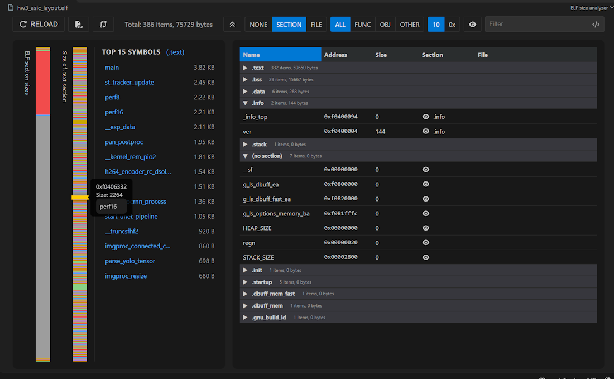

# ELF Analyzer

A powerful extension for getting detailed information about ELF files directly in Visual Studio Code.

## Features

* **Symbol Information**: View names, addresses, sizes, and sections of all symbols.
* **Interactive Charts**: Visualize section sizes and symbol distribution with stack charts.
* **Grouping**: Group symbols by Section or File to see where the size is coming from.
* **Top 15 Symbols**: Instantly see the largest symbols in your binary. Click to filter the table.
* **Diff & Compare**: Compare your current build against a previous file to see exactly what grew or shrank.
* **Export to CSV**: Export your filtered data or diff results to a CSV file for reporting.
* **Advanced Search**: Use case-insensitive search, Regular Expressions, and hide empty symbols.
* **Hex/Dec Toggle**: Switch between decimal and hexadecimal views for sizes.
* **State Persistence**: Your filters, sorting, and grouping settings are saved automatically.

## Supported Formats

* **ELF** (`.elf`, `.o`, `.axf`) — Fully supported.
* **Mach-O** (`.dylib`, `.macho`) — *Experimental support.* Basic symbol extraction and approximate sizes (calculated by address differences). Apple Silicon and x86_64 architectures are supported via `llvm-nm`.
* **PE / COFF** (`.exe`, `.dll`) — *Not yet supported.*

## Extension Settings

This extension contributes the following settings:

* `devprodest-elf-analyzer.toolchain-nm-bin-path`: Path to the `llvm-nm` or `gcc-nm` executable (default is `llvm-nm`).

## Usage

1. Open any supported binary file in VS Code.
2. The ELF Analyzer will automatically parse the file and display the symbols.
3. Use the top toolbar to filter, group, or export the data.

