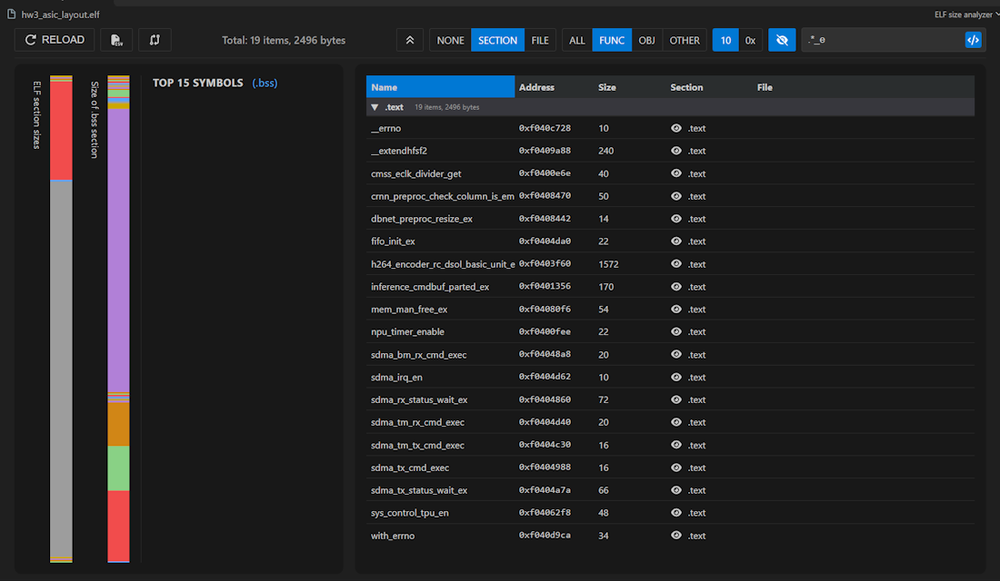

# ELF Analyzer

A powerful extension for getting detailed information about ELF files directly in Visual Studio Code.

## Features

* **Symbol Information**: View names, addresses, sizes, and sections of all symbols.
* **Dead Code Detection**: Automatically identifies unreferenced local functions and variables to help you optimize binary size.
* **External Debug Support**: Automatically detects `.gnu_debuglink` sections to load symbols and file paths from external `.debug` files.
* **Interactive Charts**: Visualize section sizes and symbol distribution with stack charts.
* **Grouping**: Group symbols by Section or File to see where the size is coming from.
* **Top 15 Symbols**: Instantly see the largest symbols in your binary (globally or filtered by section).
* **Type Filters**: Quickly filter symbols by their type (Func, Obj, Other).
* **Diff & Compare**: Compare your current build against a previous binary file to see exactly what grew or shrank.
* **Universal Toolchain**: Automatically works with both LLVM (`llvm-nm`, `llvm-readelf`) and GNU (`nm`, `readelf`, `objdump`) toolchains.
* **Export to CSV**: Export your filtered data or diff results to a CSV file.
* **Advanced Search**: Use case-insensitive search, Regular Expressions, and hide empty symbols.
* **Hex/Dec Toggle**: Switch between decimal and hexadecimal views for sizes.
* **State Persistence**: Your filters, sorting, grouping, and collapsed states are saved automatically.

## Supported Formats

* **ELF** (`.elf`, `.o`, `.axf`) — Fully supported (including stripped binaries with `.gnu_debuglink`).
* **Mach-O** (`.dylib`, `.macho`) — *Experimental support.* Basic symbol extraction and approximate sizes.
* **PE / COFF** (`.exe`, `.dll`) — *Not yet supported.*

## Extension Settings

This extension contributes the following settings:

* `devprodest-elf-analyzer.toolchain-path`: Path to the folder containing toolchain executables (e.g., `C:\Program Files\GNU Arm Toolchain\bin`).
* `devprodest-elf-analyzer.prefix`: Toolchain prefix (e.g., `arm-none-eabi-` or `llvm-`). The extension will automatically append this to `nm` and `readelf`.
* `devprodest-elf-analyzer.show-charts`: Show or hide the section charts panel (default: `true`).
* `devprodest-elf-analyzer.show-top-15`: Show or hide the Top 15 symbols panel (default: `true`).
* `devprodest-elf-analyzer.toolchain-nm-bin-path`: *(Deprecated)* Direct path to the `nm` executable. Use `toolchain-path` and `prefix` instead.

## 📦 Installation

If you are installing the extension manually from the GitHub Releases page:
1. Download the `devprodest-elf-analyzer-0.3.0.vsix` file from the assets.
2. Open VS Code.
3. Go to the Extensions view (`Ctrl+Shift+X`).
4. Click the `...` (More Actions) button in the top-right corner and select **Install from VSIX...**.
5. Select the downloaded `.vsix` file.

## Usage

1. Open any supported binary file in VS Code.
2. The ELF Analyzer will automatically parse the file (and its external debug link if present) and display the symbols.
3. Use the top toolbar to filter, group, or export the data.
4. Click "Compare" to diff the current file against an older build.

